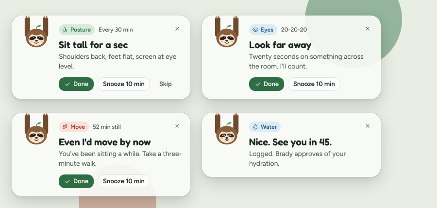
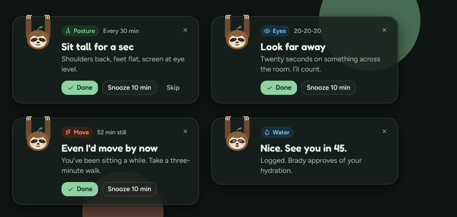
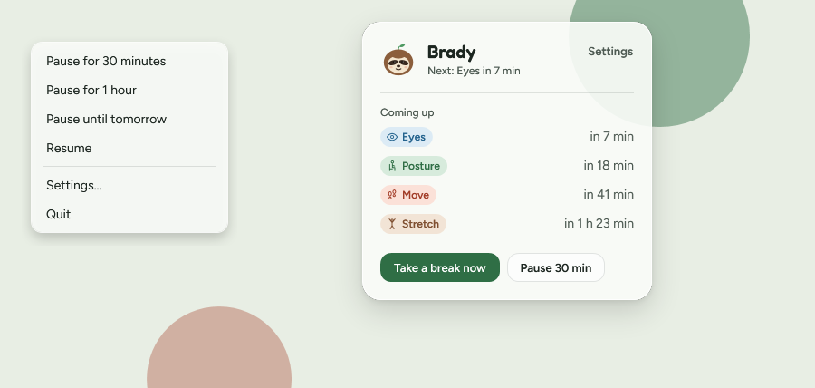
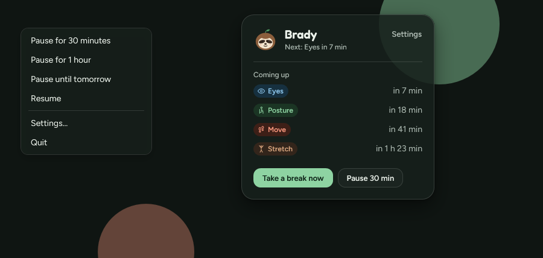
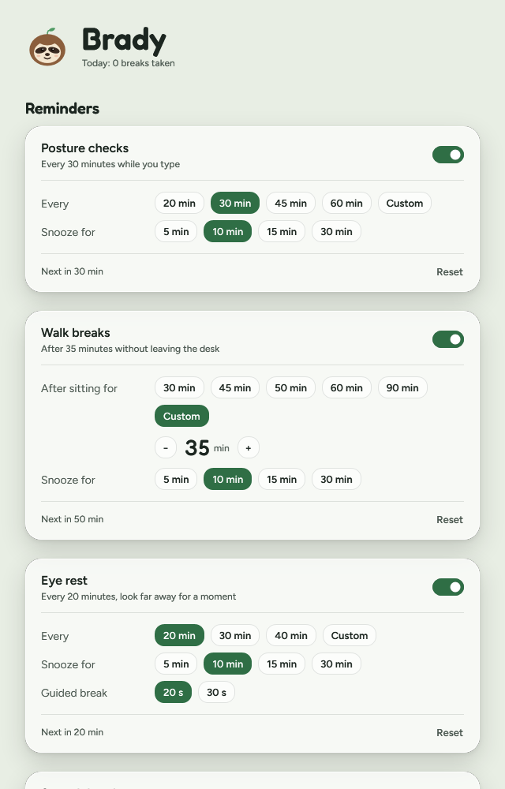
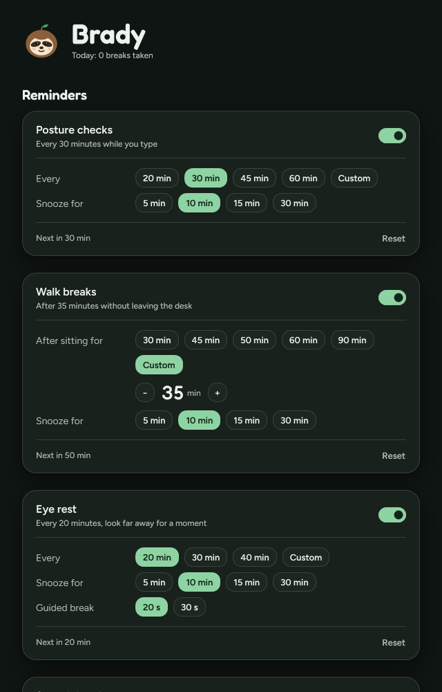

# Brady

Brady is a small Windows 11 tray app for people who sit at a PC all day. It nudges you to fix your posture, walk, rest your eyes, stretch and drink water.

The nudges come from Brady, a three-toed sloth who hangs from the top edge of every pop-up. The slowest animal alive is the one telling you to move. He's gentle about it: no guilt, no streaks, no exclamation marks.

| Light | Dark |
| --- | --- |
|  |  |

*Rendered with `Brady.exe --snapshot`, using the layout of the design reference screens.*

Brady lives in the notification area. Hover for what's next ("Brady · next: Eyes in 7 min"), left-click for the flyout, right-click to pause.

| Light | Dark |
| --- | --- |
|  |  |

Every reminder has its own timing in Settings: on or off, an interval (presets or a custom number of minutes), snooze length and, for Eyes and Stretch, a guided-break length. Changes apply as you make them.

| Light | Dark |
| --- | --- |
|  |  |

## What it does

- **Five reminder kinds:** Posture, Move, Eyes (the 20-20-20 rule), Stretch and Water. Each has its own interval.
- **Sitting time counts only while you're at the PC.** Locking the screen or stepping away for a few minutes resets the "you've been sitting" timers.
- **Never nags.** Brady leaves at least a few minutes between reminders, shows one at a time when several are due, and stays quiet during fullscreen apps, presentations, Focus sessions and your quiet hours.
- **Small glass toasts** in the corner of your screen. They never take keyboard focus, so you can keep typing while one is up.
- **Pause when you need to:** for 30 minutes, an hour, or until tomorrow morning, from the tray. A pause survives a restart.
- **Your timing:** each reminder's interval, snooze and guided-break length, plus quiet hours, how long away counts as a break, the gap between reminders, theme, and Start with Windows.
- **Light on resources.** About 13 MB working set and 0% CPU while idle, with no browser engine inside.

## Status

Brady is being built in phases:

| Phase | What | State |
| --- | --- | --- |
| 1 | Design system and the animated toast | done |
| 2 | Reminder engine and tray icon | done |
| 3 | Settings (per-reminder timing) | done |
| 5 | Installer | next |
| 4 | Guided breaks and polish | after the installer |

## Install

A per-user installer (no admin rights needed) arrives in phase 5. Until then, build from source as described below.

## Build from source

You need Windows 10 or 11 and the [.NET 10 SDK](https://dotnet.microsoft.com/download/dotnet/10.0).

```powershell
git clone https://github.com/mamehrara/Brady.git
cd Brady
dotnet build -c Release
dotnet test --project tests/Brady.Core.Tests
```

The app ends up in `src/Brady.App/bin/Release/net10.0-windows/Brady.exe`.

### Project layout

| Path | What's there |
| --- | --- |
| `src/Brady.Core` | Reminder logic and copy. No WPF and no Win32, so it's fully unit-testable. |
| `src/Brady.App` | The WPF app: theme, controls, toasts, the tray and Settings. |
| `tests/Brady.Core.Tests` | xUnit tests for Core. |
| `tools/` | Generators that turn `design/` into XAML. |
| `design/` | The brand book, tokens, reference screens, art and fonts. This is the source of truth for every color and size. |

### Regenerating the theme

Colors, type metrics and Brady's drawings are generated from `design/`, never edited by hand:

```powershell
dotnet run tools/gen-tokens.cs     # design/tokens.json -> Theme/Tokens.*.xaml
dotnet run tools/svg2xaml.cs       # design/assets/*.svg -> Theme/Mascot.xaml, Icons.xaml
```

Add `-- --check` to either command to verify that the committed files are up to date.

## Developer flags

| Flag | What it does |
| --- | --- |
| `--demo` | Cycles through every reminder kind and every way a toast can end (Done, Snooze, Skip, timeout), plus two stacked toasts reflowing, then exits. Add `--loop` to keep going. |
| `--snapshot <dir>` | Renders the toasts, the tray menu and flyout, and the Settings page in light and dark to PNGs in `<dir>`, then exits. This is how the screenshots above are made. |
| `--fps` | Shows a frame-time overlay and logs dropped frames while toasts are on screen. |
| `--theme light\|dark` | Overrides the Windows app theme. |
| `--reduced-motion` | Previews the reduced-motion path (plain fades) without changing Windows settings. |
| `--fast` | Real reminders with minutes turned into seconds (intervals, gap and snooze), to see the whole pipeline in under a minute. |
| `--quit` | Asks a running Brady to exit cleanly. |
| `--background` | Used by the Windows startup entry; Brady starts straight into the tray either way. |
| `--hardware` | Uses GPU rendering. Software rendering is the default because it's just as smooth for Brady's small windows and uses far less memory. |

Logs are written to `%LocalAppData%\Brady\logs`; settings live in `%AppData%\Brady\settings.json`.

## License

Brady's code is released under the [MIT License](LICENSE).

It uses the [Fredoka](https://fonts.google.com/specimen/Fredoka) and [Figtree](https://fonts.google.com/specimen/Figtree) fonts, which are licensed separately under the SIL Open Font License 1.1; see `design/fonts/OFL-*.txt`.
